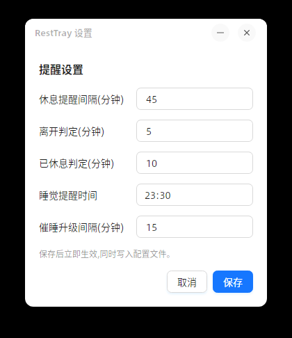

# RestTray

跨平台托盘常驻提醒工具(Windows / Linux)。核心理念:**所有提醒以"人在电脑前活动"为前提**——人在才提醒,不在就跳过/顺延,从根上消灭"忘关闹钟"的问题。

## 功能

- **休息提醒**:累计"活跃时间"(有键鼠输入才算)达到间隔(默认 45 分钟)→ 系统通知提醒休息;离开(空闲超 5 分钟)不计时;空闲超 10 分钟视为已休息,计时清零。
- **睡觉提醒**:到点(默认 23:30)检测是否活跃:活跃 → 提醒;不停手则每 15 分钟升级一次(最多再提醒 3 次);不活跃 → 当晚跳过。
- **托盘图标**:tooltip 实时显示当前活跃时长与距下次休息的剩余时间;右键菜单:暂停提醒 1 小时 / 恢复、设置、退出。
- **设置窗口**:AtomUI(Ant Design 风格)界面,修改后保存立即生效并写入配置文件。
- **配置文件**:JSON,位于标准配置目录(Windows `%APPDATA%\RestTray\config.json`;Linux `~/.config/RestTray/config.json`),首次运行自动生成默认值,可手工编辑。

## 项目结构

```
src/RestTray.Core/        核心逻辑库(纯 .NET,无 UI 依赖,未来可被 ASP.NET Core 等宿主复用)
  Abstractions/           IClock / IIdleTimeSource / INotifier 抽象
  Config/                 ReminderConfig + ConfigStore(JSON 读写)
  Engine/                 ReminderEngine 状态机(休息计时 / 睡觉催醒 / 暂停恢复)
src/RestTray/             Avalonia 12 + AtomUI 桌面应用(托盘 + 设置窗口)
  Platform/Idle/          Windows: GetLastInputInfo;Linux: XScreenSaver(libXss)→ xprintidle → 降级"始终活跃"
  Platform/Notify/        Windows: WinRT Toast;Linux: notify-send(libnotify)
  Tray/                   TrayIcon 与右键菜单、tooltip 刷新
  Settings/               AtomUI 设置窗口
tests/RestTray.Core.Tests/ 状态机单元测试(xunit,虚拟时钟注入,不依赖真实等待)
tests/RestTray.UiTests/   Headless UI 截图测试(Avalonia.Headless + xunit v3,真实 Skia 渲染,产物见下方截图)
```

## 构建

需要 .NET SDK 10(见 `global.json`,10.0.403,rollForward latestPatch)。

```bash
dotnet build RestTray.slnx          # 编译(含 net10.0 与 net10.0-windows 双目标)
dotnet test  RestTray.slnx          # 运行单元测试
```

发布(以 Linux x64 自包含为例):

```bash
dotnet publish src/RestTray/RestTray.csproj -c Release -f net10.0 \
    -r linux-x64 --self-contained -o artifacts/linux-x64
```

Windows 发布:

```bash
dotnet publish src/RestTray/RestTray.csproj -c Release -f net10.0-windows10.0.17763.0 \
    -r win-x64 --self-contained -o artifacts/win-x64
```

## 界面截图

以下截图由 `tests/RestTray.UiTests` 在无显示环境下通过 Avalonia Headless(真实 Skia 渲染)自动生成,每次 `dotnet test` 都会刷新,保证与当前 UI 一致。

默认配置:



自定义配置(间隔 90 分钟、睡觉提醒 22:15 等):


> 托盘图标与右键菜单由操作系统原生渲染,headless 环境无法截取,故未收录。

## 说明与已知限制

- Windows 专属代码(GetLastInputInfo、Toast)通过 `#if WINDOWS` + `net10.0-windows10.0.17763.0` 目标框架做条件编译隔离,Linux 构建完全不包含 Windows API。
- 托盘右键菜单由操作系统原生渲染(Avalonia NativeMenu),不参与 AtomUI 主题;AtomUI 样式仅作用于应用内窗口(设置窗口)。
- 空闲检测按会话类型走降级链,每步都有日志。Wayland 会话:D-Bus GNOME IdleMonitor(GNOME/Cinnamon)→ D-Bus freedesktop ScreenSaver → Wayland ext-idle-notify(KDE Plasma/wlroots,基于 libwayland P/Invoke)→ XScreenSaver → xprintidle;纯 X11 会话保持 XScreenSaver → xprintidle。全部失败时降级为"始终活跃"并在日志中给出警告。
  - KDE Plasma(Wayland)的 `org.freedesktop.ScreenSaver.GetSessionIdleTime` 返回 NotSupported(KWin 未实现),由 ext-idle-notify 路径承接。
  - ext-idle-notify 协议只有"空闲超阈值/恢复活动"事件,无精确查询:空闲起点按事件时刻回推阈值(5 秒)估算,且无法感知应用启动前已有的空闲(低估部分随运行时间收敛)。
  - 诊断参数 `RestTray --print-idle [观察秒数]`:打印命中的检测方案与空闲秒数,观察模式每 2 秒采样一次。
- AtomUI 包为 `AtomUI.Desktop.Controls`(6.x 线,支持 .NET 10 / Avalonia 12);旧的 `AtomUI` 包(5.x)仅支持 Avalonia 11,不可混用。
